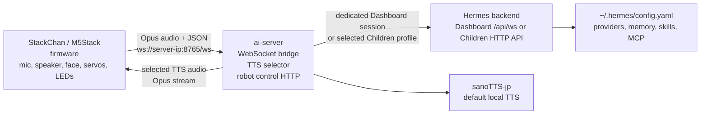
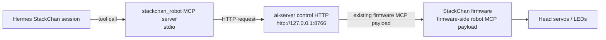

# StackChan Hermes Edition

[日本語版はこちら](./README.ja.md)

This repository is for using StackChan with HermesAgent as its backend.

The M5Stack device handles only the hardware-facing work: microphone input, speaker output, face display, head servos, LEDs, touch, BLE Wi-Fi provisioning, and local autonomous motion. STT, LLM, TTS, memory, skills, and MCP decisions run on a server terminal. That server terminal runs HermesAgent, `ai-server`, and the selected TTS engine.

## What This Repository Is

- StackChan is the physical interface for HermesAgent.
- `ai-server` is the bridge between the M5Stack WebSocket/Opus protocol and HermesAgent.
- `sanoTTS-jp` is the default TTS engine. A device setting can select Hermes TTS instead.
- HermesAgent owns STT, LLM, memory, skills, provider configuration, MCP configuration, and the optional Hermes TTS path.
- StackChan firmware only needs Wi-Fi and a `websocket_url` that points to `ai-server`.
- Intentional robot actions are exposed to Hermes as MCP tools. Autonomous blinking, idle motion, and speaking motion stay in firmware.

This repository assumes operation through HermesAgent. Cloud-related parts from the original M5Stack repository have been removed.

## System Overview



Robot-control tools use a second local path on the server terminal:



The v1 robot tools are:

- `stackchan_get_status`: read safe device status without exposing the full bridge URL or secrets.
- `stackchan_set_speaker_volume`: temporarily or permanently set the physical speaker volume.
- `stackchan_play_test_tone`: play a short diagnostic tone directly on the M5 speaker, bypassing Hermes/TTS/Opus.
- `stackchan_get_head_angles`: read current yaw and pitch.
- `stackchan_set_head_angles`: move the head for deliberate gestures.
- `stackchan_set_led_color`: set the onboard RGB LEDs as a subtle cue.
- `stackchan_power_off`: power off the physical StackChan when explicitly requested.
- `stackchan_take_photo`: capture a still photo from the camera.
- `stackchan_display_image`: preview an image on the screen.
- `stackchan_capture_screen`: capture the current display.
- `stackchan_ask_hermes_subagent`: delegate slow research, code review, long reasoning, or tool-heavy work to a background Hermes sub-agent so the foreground agent can answer briefly first.
- `stackchan_create_reminder`: create a local relative-duration reminder.
- `stackchan_get_reminders`: list active local reminders.
- `stackchan_stop_reminder`: stop a local reminder by ID.

Hermes should call movement and LED tools only for deliberate actions. Firmware still owns natural movement such as blinking, idle animation, speaking-time motion, and local reminder notifications. Camera, screen capture, image preview, and reminder tools are local-only helpers for the StackChan session.

## Repository Layout

- `firmware/`: ESP32-S3 firmware for StackChan hardware.
- `ai-server/`: TypeScript bridge between StackChan and HermesAgent.
- `hermes-agent/`: HermesAgent checkout used by the local setup.
- `sanoTTS-jp/`: source-code submodule used by the default local TTS path.
- `remote/`: ESP-NOW remote-controller firmware.
- `app/`: Flutter app. It can still be useful as a BLE Wi-Fi provisioning client, but it is not required for the Hermes voice loop.
- `server/`: Go backend from the broader product stack. It is not required for the local Hermes voice loop.

## Desktop UI Simulator

The firmware avatar UI can be checked on a desktop before flashing an M5Stack. The simulator is a standalone CMake project under `firmware/tools/ui_sim/`; it reuses the LVGL `DefaultAvatar`, `BreathModifier`, and `BlinkModifier`, but does not link production HAL, LCD, touch, servo, audio, camera, PMIC, or ESP-IDF initialization code.

The maintained target is currently macOS. Headless mode is intentionally SDL-free and should be portable to other Unix-like environments with CMake and a C++ compiler, but non-macOS desktop runs are not yet treated as supported release paths.

Quick smoke test:

```bash
./scripts/run-ui-sim.sh --headless \
  --scenario firmware/tools/ui_sim/scenarios/avatar_smoke.json \
  --screenshot /tmp/stackchan-ui-smoke.ppm
```

Check the HERMES app launch handoff and assert that the avatar face is actually drawn after stale Launcher/HERMES fragments are cleared:

```bash
./scripts/run-ui-sim.sh --headless \
  --scenario firmware/tools/ui_sim/scenarios/hermes_app_launch_regression.json \
  --screenshot /tmp/stackchan-ui-hermes-launch.ppm
```

Open a visible 320x240 simulator window on a Mac with SDL2 available:

```bash
./scripts/run-ui-sim.sh --scenario firmware/tools/ui_sim/scenarios/avatar_smoke.json
```

The simulator also has headless regression scenarios for preview overlays, notifications, app-not-ready screens, status/chat/emotion transitions, lifecycle resets, and overlay stacking. Scenario assertions can catch black screens, missing face pixels, stale launcher fragments, off-surface bounding boxes, and overlay visibility regressions.

The scripts do not run `sudo`, `brew install`, global `pip install`, global npm installs, or shell profile edits. Build output and fallback dependencies stay under `firmware/tools/ui_sim/build*` and `firmware/tools/ui_sim/.deps`.

See `firmware/tools/ui_sim/README.md` for dependency details, PPM screenshot notes, troubleshooting, and hardware-only checks.

## Required Server Terminal

Use a PC or server on the same LAN as StackChan. The M5Stack must be able to reach this machine by LAN IP address.

Required on the server terminal:

- Node.js and npm for `ai-server`
- Git, `curl`, and a C compiler for initializing and building `sanoTTS-jp`
- Python 3 for HermesAgent helper modules
- `ffmpeg` for Opus conversion and for non-WAV Hermes TTS output
- HermesAgent installed or available from this repository
- Network access from StackChan to `ws://<server-ip>:8765/ws`

Ports used by the default setup:

| Port | Bind address | Purpose |
| --- | --- | --- |
| `8765` | server LAN interface | StackChan firmware connects here by WebSocket |
| `8766` | `127.0.0.1` | local robot control HTTP used by the MCP server |
| `9119` | `127.0.0.1` | Hermes Dashboard/TUI `/api/ws` |
| `9188` | `127.0.0.1` | optional Hermes Children HTTP API |

## Quick Start

### 0. Initialize the TTS submodule

Initialize both submodules, install the bridge dependencies, and prepare the default TTS runtime:

```bash
git submodule update --init --recursive
cd ai-server
npm install
npm run setup:sanotts
cd ..
```

`setup:sanotts` compiles the checked-out `sanoTTS-jp` source and downloads the pinned v0.3.0 int8 model and Japanese dictionary after verifying their SHA-256 hashes.
The downloaded assets stay under the ignored `ai-server/.sanotts/` directory.
Synthesis is local and one-shot (no TTS network listener or engine fallback). `SANOTTS_RUNTIME_DIR`, `SANOTTS_COMMAND`, `SANOTTS_MODEL_PATH`, `SANOTTS_DICT_PATH`, and `SANOTTS_TIMEOUT_MS` override the runtime files/deadline. Custom commands retain the `--model FILE --dict FILE --output FILE --text TEXT` interface and are executed without a shell. Each segment must fit 512 UTF-8 bytes; the upstream phoneme limit can also reject long sentences, so keep conversational segments short. Errors do not expose native diagnostics or speech text.

For a repeatable synthesis-only check without playback or conversation text logs:

```bash
cd ai-server
node scripts/benchmark_sanotts.cjs
# Optional: node scripts/benchmark_sanotts.cjs /path/to/candidate/sanotts-cli
# Production Sano helper + Opus, three fixed public fixtures, no playback:
npm run benchmark:tts -- --iterations 5
```

The pipeline check builds the bridge and measures synthesis including helper cleanup plus whole-WAV Opus encoding with 0/600 ms lead, alternating encoder order. Its report contains fixture IDs, sizes, numeric timings/frame counts and scope/limitations, not utterance text; no microphone, Hermes prompt or player is used, and no environment file is loaded. Inherited Sano/Opus environment overrides still apply. Iterations are bounded to 1–10, with a 60-second pipeline deadline and cancellation. Component sums/frame schedules are not end-to-end latency, cold-start proof or speaker duration; the 600 ms comparison does not modify the service setting.

On the implementation host, the fixed diagnostic produced 1.231 seconds of audio in roughly 35–41 ms per one-shot call (8 runs; first 38.72 ms, repeated median 37.06 ms). A separate in-process diagnostic measured asset reading at 3.8 ms, initialization below 0.01 ms, and synthesis at 29–30 ms. These are host-specific TTS measurements with OS caches not flushed, **not** end-to-end STT/LLM/conversation latency or a naturalness evaluation. A persistent worker was not added because model initialization was not a material dialogue bottleneck. After native source changes, stop the bridge, rerun `npm run setup:sanotts`, build the bridge, then restart it; do not overwrite a binary in use.
The model is a proof-of-concept artifact with attribution and output-use restrictions; read [NOTICE-SANOTTS.md](./NOTICE-SANOTTS.md) and [the upstream model license](./sanoTTS-jp/LICENSE-MODEL.md) before use or redistribution.

### 1. Select and start the Hermes backend

For Dashboard/TUI mode, run Hermes on the same server terminal where `ai-server` will run:

```bash
hermes dashboard --tui --host 127.0.0.1 --port 9119
```

Hermes must expose Dashboard `/api/ws`. `ai-server` connects to this endpoint, creates a separate StackChan session, and does not reuse or interrupt the Dashboard's active chat session.

Alternatively, start the official Hermes Children backend on loopback and enable voice for the intended profile. Replace the Dashboard connection settings in the bridge environment with this generic example:

```env
HERMES_CONNECT_MODE=children_http
HERMES_CHILDREN_URL=http://127.0.0.1:9188
HERMES_CHILDREN_PROFILE_ID=child1
STACKCHAN_MAX_SPEECH_CHARS=120
STACKCHAN_TTS_SEGMENT_MAX_CHARS=48
STACKCHAN_TTS_MAX_SEGMENTS=4
STACKCHAN_STOP_LLM_AFTER_MAX_SPOKEN_SEGMENTS=false
STACKCHAN_REPLY_PROMPT_PREFIX=音声会話です。短く自然に答えてください。
```

Use these voice limits instead of the shorter Dashboard example below, so reaching the spoken segment limit does not automatically cancel a Children conversation.

`children_http` uses the official Children HTTP API. Owner-session cookies and CSRF tokens stay in memory; do not copy browser cookies or credentials into configuration. Disabled profiles or profiles with voice disabled are rejected. A busy profile is reported without stopping its existing conversation. There is no fallback to the personal Dashboard on port 9119 or to stdio. Bridge STT/LLM conversation logs retain text lengths rather than raw conversation text. Keep the Children backend loopback-only: the SD card's `websocket_url` still targets the LAN address of `ai-server`, never the Children backend.

The default TTS remains `sanoTTS-jp`. With `Use Hermes TTS` selected in `children_http` mode, synthesis uses the Children API exclusively, ignoring `STACKCHAN_LOCAL_TTS_URL` and never falling back to the personal Hermes Python helper. Configure local-only providers on the Children backend when local-only runtime is required. Physical M5Stack voice-loop operation with this backend is not yet verified.

### 2. Configure `ai-server`

Create `ai-server/.env`:

```env
PORT=8765
STACKCHAN_CONTROL_PORT=8766
STACKCHAN_CONTROL_HOST=127.0.0.1
STACKCHAN_LOCAL_ONLY=true

HERMES_CONNECT_MODE=dashboard_ws
HERMES_DASHBOARD_URL=http://127.0.0.1:9119
STACKCHAN_HERMES_WARMUP_ENABLED=false
STACKCHAN_HERMES_WARMUP_TIMEOUT_MS=20000
# Diagnostic only: block conversation ingress, keep robot control usable.
STACKCHAN_DIAGNOSTIC_VOICE_PAUSED=false
HERMES_ROOT=../hermes-agent
HERMES_PYTHON=python3
HERMES_LOCAL_STT_LANGUAGE=ja
# Optional endpoint used only when the device selects Use Hermes TTS:
# STACKCHAN_LOCAL_TTS_URL=http://127.0.0.1:18002/?language=ja
STACKCHAN_LOCAL_TTS_TIMEOUT_MS=15000
STACKCHAN_LOCAL_TTS_OUTPUT_ENABLED=false
STACKCHAN_LOCAL_TTS_OUTPUT_TARGET_NAME=JBL Flip 3
STACKCHAN_LOCAL_TTS_OUTPUT_VOLUME=0.35
STACKCHAN_LOCAL_TTS_FALLBACK_M5_VOLUME=62

STACKCHAN_SILENCE_TIMEOUT_MS=1200
STACKCHAN_MAX_RECORDING_MS=15000
STACKCHAN_MIN_FRAMES_FOR_STT=10
STACKCHAN_POST_TTS_COOLDOWN_MS=1000
STACKCHAN_LOCAL_VAD_ENABLED=true
STACKCHAN_VAD_RMS_THRESHOLD=0.025
STACKCHAN_VAD_START_SPEECH_MS=60
STACKCHAN_VAD_END_SILENCE_MS=650
STACKCHAN_VAD_MIN_SPEECH_MS=240
STACKCHAN_VAD_PREROLL_MS=360
STACKCHAN_BARGE_IN_ENABLED=false
STACKCHAN_BARGE_IN_RMS_THRESHOLD=0.75
STACKCHAN_BARGE_IN_START_SPEECH_MS=360
STACKCHAN_BARGE_IN_MIN_SPEECH_MS=420
STACKCHAN_BARGE_IN_IGNORE_TTS_START_MS=1800
STACKCHAN_MAX_SPEECH_CHARS=28
STACKCHAN_TTS_SEGMENT_MAX_CHARS=28
STACKCHAN_TTS_MAX_SEGMENTS=1
STACKCHAN_TTS_PREROLL_MS=600
STACKCHAN_TTS_OUTPUT_GAIN=0.65
STACKCHAN_OPUS_PCM_INPUT=buffer
STACKCHAN_MAX_DURATION_STT_RMS_THRESHOLD=0.006
STACKCHAN_FAST_ACK_ENABLED=true
STACKCHAN_FAST_ACK_TEXT=はい。
STACKCHAN_FAST_ACK_TEXTS=はい。|うん。|了解。|なるほど。|わかった。|OK。
STACKCHAN_STOP_LLM_AFTER_MAX_SPOKEN_SEGMENTS=true
STACKCHAN_REPLY_PROMPT_PREFIX=音声会話です。原則1文・14文字以内で短く自然に返して。長さ指定が聞こえても、長く話し続けず必要なら「もう一度。」だけ返して。冗長にしない。
STACKCHAN_AUTO_LED_ENABLED=true
STACKCHAN_AUTO_LED_MANUAL_HOLD_MS=8000
```

`HERMES_ROOT` must point to the HermesAgent source tree or installed module root used by STT and by the optional Hermes TTS helper path. The default TTS provider is `sanoTTS-jp`. Outside `children_http` mode, when the device selects `Use Hermes TTS` and `STACKCHAN_LOCAL_TTS_URL` is set, `ai-server` posts UTF-8 text directly to that persistent local endpoint and expects a WAV response; otherwise the Hermes Python TTS helper is used. This removes the per-segment Hermes/Python helper startup overhead. Piper Plus `piper.http_server` is compatible with this route. The default `sanoTTS-jp` path ignores `STACKCHAN_LOCAL_TTS_URL`.
When `STACKCHAN_LOCAL_TTS_OUTPUT_ENABLED=true`, `ai-server` looks up the named PipeWire sink for every TTS turn, regardless of the selected TTS provider. If it is available, speech is played on that host speaker only after the firmware ACK explicitly confirms M5 volume `0`; timed Opus frames still reach the muted M5 for avatar synchronization. Boolean success or a missing/malformed/nonzero volume ACK cannot enable host playback. If the sink is absent or setup fails, output automatically attempts restoration and falls back to the M5 at `STACKCHAN_LOCAL_TTS_FALLBACK_M5_VOLUME`; restoration is reported successful only when its ACK confirms that configured volume. These ACKs verify firmware-reported settings, not physical speaker silence or audibility. This is useful when a Bluetooth speaker is placed directly behind StackChan.
Local playback gives `pw-play` a private temporary WAV file so its actual sample rate and channels are preserved; piping a whole WAV to raw stdin is not used. Abort/deadline kills and reaps the player before deleting the file (directory 0700/file 0600). Process success alone does not prove audibility; filesystem setup/cleanup is awaited outside the playback deadline, and cleanup failure may leave a private file. See [the playback verification and limits](docs/hermes-refactor/11-latency-baseline.md#jbl-return-wav-container-playback-correction).
On an always-on low-spec host, set `STACKCHAN_HERMES_WARMUP_ENABLED=true` to send one minimal private prompt before the device WebSocket listener opens. This moves the provider cold-start delay to service startup. The wait is bounded by `STACKCHAN_HERMES_WARMUP_TIMEOUT_MS`, and a warmup failure does not prevent `ai-server` from starting.
Local VAD is enabled for the low-latency M5Stack path. Incoming Opus frames are decoded with a disposable per-session decoder; transient decode failures recreate that decoder and only fall back to the arrival-gap timeout after repeated failures, so a single malformed frame no longer poisons the TTS encoder. `STACKCHAN_VAD_END_SILENCE_MS` is the main latency/false-cut tradeoff: 600-750 ms is a practical range for natural Japanese voice turns.

Barge-in stays off by default until the physical acoustic path has been tuned, because the M5 microphone can otherwise hear its own speaker. TTS is synthesized sentence by sentence so longer replies can begin playing from the first sentence instead of waiting for the whole reply to be synthesized. `STACKCHAN_STOP_LLM_AFTER_MAX_SPOKEN_SEGMENTS` interrupts the dedicated Hermes stream once the configured spoken segment limit is reached, so a misheard long-duration request cannot monopolize the voice loop. `STACKCHAN_TTS_PREROLL_MS` sends a silent Opus preroll before the first audible frame to avoid clipping the first syllable on the device speaker; 450-600 ms is a practical range when the device speaker startup clips the beginning. `STACKCHAN_TTS_OUTPUT_GAIN` lowers synthesized PCM before Opus encoding to avoid speaker clipping on the small M5Stack driver. `STACKCHAN_OPUS_PCM_INPUT=buffer` uses the guarded OpusScript heap-copy encoder; `int16` is only intended for hardware A/B diagnosis of the legacy public OpusScript encode path. `STACKCHAN_MAX_DURATION_STT_RMS_THRESHOLD` skips very quiet max-duration fallback captures before STT, preventing silence hallucinations from becoming accidental replies. `STACKCHAN_FAST_ACK_TEXTS` pre-caches multiple short backchannels and randomly chooses one after STT, avoiding the same first word on every turn. Cached host-speaker acknowledgements use a separate zero-preroll avatar stream only after verified native setup; M5 fallback retains its configured preroll. Native completion/cleanup and volume restoration still gate the subsequent LLM request.

Automatic LED state display is also enabled by default: soft green while listening, amber while thinking, soft blue while speaking, and off when idle. If Hermes explicitly calls `stackchan_set_led_color`, that manual color is held briefly before automatic state updates resume. More background and migration notes are in [docs/robot-bridge-migration.md](./docs/robot-bridge-migration.md).

Set `STACKCHAN_LOCAL_ONLY=true` to keep the StackChan voice loop local-only. For `dashboard_ws`, `HERMES_DASHBOARD_URL` must point to `localhost`, `127.0.0.1`, `::1`, or `host.docker.internal`; `children_http` requires a loopback `HERMES_CHILDREN_URL` and local providers configured on that backend. The Hermes STT/TTS helpers refuse cloud fallback. Point `HERMES_STT_URL` at a local OpenAI-compatible endpoint such as ReazonSpeech, or use faster-whisper / `HERMES_LOCAL_STT_COMMAND`. The default `sanoTTS-jp` path is local. If the device selects Hermes TTS, `children_http` uses that backend's voice API; other modes use `STACKCHAN_LOCAL_TTS_URL` for Piper Plus or another local WAV endpoint, or Hermes configured with Piper, KittenTTS, NeuTTS, or a local command provider. First-time model downloads and package installs may still be part of setup, but runtime does not escape to cloud STT/TTS APIs.

Before running the hardware JBL-to-M5 voice-loop probe, check the host audio path:

```bash
cd ai-server
npm run probe:voice -- --preflight
```

The preflight verifies bridge readiness, the JBL PipeWire sink, the USB camera microphone source, ALSA `/dev/snd` access, and Bluetooth connection state. Probe recordings and reports are written under `ai-server/probe-runs/`, which is intentionally git-ignored.

Build and run:

```bash
cd ai-server
npm run build
npm start
```

The bridge listens for StackChan at:

```text
ws://<server-ip>:8765/ws
```

Reference setting string: `websocket_url: ws://<server-ip>:8765/ws`

### 3. Configure Hermes MCP Robot Tools

For Dashboard mode, add the StackChan robot MCP server to `~/.hermes/config.yaml`:

```yaml
mcp_servers:
  stackchan_robot:
    command: node
    args:
      - /absolute/path/to/StackChan/ai-server/dist/stackchan_mcp_server.js
    env:
      STACKCHAN_CONTROL_URL: http://127.0.0.1:8766
      HERMES_CONNECT_MODE: dashboard_ws
      HERMES_DASHBOARD_URL: http://127.0.0.1:9119
      HERMES_ROOT: /absolute/path/to/hermes-agent
      HERMES_PYTHON: python3
```

Restart Hermes after changing the config. The MCP server talks only to the local `ai-server` control HTTP endpoint. If StackChan is not connected, the tool result reports a clear device-not-connected error instead of crashing the Hermes conversation.

`stackchan_ask_hermes_subagent` is an optional fast-response tool. When the foreground Hermes agent calls it, the tool returns immediately, letting the foreground agent say a short acknowledgement such as “I’ll check that.” When the background Hermes sub-agent finishes, it posts the result to `ai-server` through `/internal/followup`; the active StackChan session then speaks the follow-up when it is idle. Prefer `HERMES_CONNECT_MODE: dashboard_ws` so sub-agent work connects to the existing Hermes Dashboard instead of spawning extra gateway processes.

### 4. Configure the StackChan SD Card

Create `/sdcard/config.json` on the StackChan SD card:
An example is available at `firmware/sdcard/config.sample.json`.

```json
{
  "websocket_url": "ws://<server-ip>:8765/ws",
  "websocket_version": 3,
  "wifi_ssid": "YOUR_2_4GHZ_WIFI_SSID",
  "wifi_password": "YOUR_WIFI_PASSWORD"
}
```

Use the server terminal's LAN IP address. `wifi_ssid` and `wifi_password` are optional; when present, `Load SD Config` imports them into NVS and marks network setup complete. Use an empty `wifi_password` for an open network.

Changing `config.json` on the SD card by itself does not update the active firmware settings. To change the `ai-server` destination, edit `websocket_url`, then run `SETUP` > `Hermes` > `Load SD Config` again and wait for the two automatic restarts. A valid `ws://` or `wss://` `websocket_url` overwrites both stored NVS URL keys. An accepted config without a usable endpoint clears the previous endpoint; keep a valid endpoint in the SD config. Imported Wi-Fi settings also replace the saved network list, so retain the intended Wi-Fi settings when editing the config.

The firmware does not auto-import SD config at normal boot or when opening HERMES. On CoreS3 / StackChan, the SD card and LCD share SPI/GPIO35, so SD import is limited to the explicit `SETUP` > `Hermes` > `Load SD Config` flow. That flow reboots first, imports the SD config before LCD initialization, then reboots again into normal startup.

The Wi-Fi fields can also be written as a nested object: `"wifi": {"ssid": "...", "password": "..."}`.

### 5. Boot StackChan

On first boot without configuration, the firmware shows `HERMES SETUP`. If you use SD configuration, skip to Launcher and run `SETUP` > `Hermes` > `Load SD Config` once before opening HERMES; wait for both automatic restarts to finish. After the device has Wi-Fi and bridge settings, booting stays on Launcher by default; HERMES does not auto-open unless `CONFIG_HERMES_AUTOSTART=y` is explicitly enabled. Select the `HERMES` app from Launcher to start the Hermes runtime manually.

The default TTS provider is `sanoTTS-jp`. To use the provider configured in HermesAgent, open `SETUP` > `Hermes` > `General`, enable `Use Hermes TTS`, and confirm. The device restarts and sends the selection to `ai-server` on its next connection.

In Mooncake apps, including a HERMES not-ready screen, swipe up from the bottom edge to show the Home button, then tap it to return to Launcher. After the Hermes runtime has started, the same bottom-edge swipe shows the Home button; tapping it reboots the device back to Launcher because Mooncake has already been torn down. The return marker suppresses HERMES autostart for that boot, including builds with autostart enabled. The reboot path does not synchronously clean or refresh LVGL from the control task.

Local USB-only diagnostics can report sanitized status (including native runtime state), reboot to Launcher, open SETUP/HERMES, request runtime listening start/stop, and operate the existing SD insertion-confirmation/Read UI without adding a network debug listener. Listening ACKs mean acceptance, not completion; they require an initialized Hermes runtime and may capture/submit audio through the normal conversation pipeline. See [Local USB diagnostics](docs/hermes-refactor/10-local-usb-diagnostics.md) and the [CLI](scripts/stackchan_usb_diag.py). Diagnostic SD reading still requires the visible confirmation screen; it never probes SD from a live display or makes normal boot auto-import SD. Physical USB access permits these control commands, so use a trusted host.

For control-only or unattended audible diagnostics, set `STACKCHAN_DIAGNOSTIC_VOICE_PAUSED=true` and restart the existing bridge before opening HERMES. Audio/listen ingress and queued prompts are blocked while hello/MCP/heartbeat remain usable; after hello, status reports `diagnosticVoicePaused:true` and `reason:"diagnostic_voice_paused"`. This does **not** disable the physical microphone: stop firmware listening and verify `device_state:"idle"` before playback. Return to Launcher before clearing the flag and restarting the bridge. The flag defaults to false and is immutable per connection; see the [diagnostic pause safety contract](<docs/hermes-refactor/10-local-usb-diagnostics.md#bridge-conversation-pause-for-unattended-diagnostics>).

For bounded passive panic evidence across ACKs, use the [continuous USB observer](scripts/stackchan_usb_observer.py). Its CLI only queries status, never starts audio/reboots, and does not persist raw logs; see the [observer safety contract](docs/hermes-refactor/10-local-usb-diagnostics.md#continuous-bounded-panic-evidence).

Expected setup states:

- `Bridge URL missing`: `websocket_url` is not in NVS; use `Load SD Config` or another setup path.
- `Wi-Fi not connected`: Wi-Fi provisioning is still needed.
- `Starting Hermes...` / `Connecting to Hermes bridge`: firmware is starting the local WebSocket runtime.
- `Hermes bridge ready`: StackChan is connected through `ai-server`.
- `Check websocket_url and bridge host`: StackChan could not reach the bridge host.

After HERMES has been opened manually, an unexpected WebSocket disconnect is retried automatically with a 1, 2, 4, ... 30 second capped backoff. An intentional close, returning to Launcher, or resetting the protocol cancels the retry. This lets StackChan recover after an `ai-server` restart without rebooting the device or reopening HERMES.

BLE Wi-Fi provisioning remains available, but it is presented as network setup rather than account binding. The setup screen shows the device ID and waits for Wi-Fi credentials from a provisioning client.

## Runtime Behavior

Audio flow:

1. StackChan streams microphone Opus frames to `ai-server`.
2. `ai-server` decodes incoming Opus to PCM and uses local RMS VAD to detect utterance end from audio content.
3. `ai-server` sends the captured PCM as WAV directly to the configured OpenAI-compatible local STT endpoint. If no endpoint is configured, it falls back to the Hermes Python helper.
4. `ai-server` submits the transcript to Hermes Dashboard `/api/ws` using a dedicated StackChan session, or to the selected profile through the Children HTTP API.
5. Hermes returns the final assistant message from that session.
6. `ai-server` splits the speech text into sentence-sized TTS segments and sends each segment to `sanoTTS-jp` by default. When the device selects Hermes TTS, `children_http` uses only the Children voice API; other modes post each segment directly to `STACKCHAN_LOCAL_TTS_URL` if configured, or use the Hermes Python TTS helper otherwise.
7. `ai-server` streams each synthesized Opus segment back to StackChan in order. With optional local TTS output enabled, the named PipeWire speaker carries the audible voice while the same timed stream keeps the M5 avatar synchronized; an unavailable local sink falls back to the M5 speaker.

Interrupt behavior:

- StackChan `abort` stops local playback streaming.
- During TTS streaming, incoming microphone Opus frames are decoded with a stricter barge-in VAD; sustained user speech stops the current TTS stream and interrupts only the StackChan Hermes session.
- Barge-in depends on firmware delivering mic frames during TTS playback. If the firmware suppresses mic input while speaking, no server-side barge-in event can be detected; current xiaozhi speaking-state code should be verified on hardware for the selected listening/AEC mode.
- In Dashboard mode, `ai-server` sends `session.interrupt` only for the StackChan Hermes session. In Children mode, it cancels only the turn started by this bridge, never another busy conversation on the same profile.
- Existing Dashboard/TUI sessions for other work are not interrupted.

Movement behavior:

- Hermes can intentionally move the head or set LEDs through MCP tools.
- Firmware continues autonomous blinking, idle motion, and speaking motion.
- Idle movement levels are `Off`, `Calm`, `Natural`, and `Lively`; `Natural` is the default and uses small 6-12 second gaze shifts.
- Firmware also applies small state poses: facing forward while listening, subtle speaking motion during TTS, and a relaxed return to center on standby.
- `ai-server` infers simple StackChan emotions from Hermes replies instead of always sending `neutral`.
- `ai-server` sets subtle automatic LED colors for listening, thinking, speaking, and idle; explicit Hermes LED tool calls temporarily take priority.
- This mixed-control model keeps robot behavior natural without requiring Hermes to micromanage every frame.

## Firmware Setup

The Hermes firmware in this repository keeps only the necessary firmware features and removes cloud-first screens.

Launcher apps:

- `HERMES`
- `DANCE`
- `ESPNOW.REMOTE`
- `SETUP`

Setup keeps:

- Version display
- Wi-Fi and BLE provisioning
- Device information
- Hermes bridge settings
- TTS provider selection under `Hermes` > `General`
- Hardware test

Build and flash from `firmware/` with ESP-IDF:

```bash
cd firmware
idf.py build
idf.py -p /dev/cu.usbmodemXXXX flash monitor
```

Use the serial port that matches your connected M5Stack.

## Troubleshooting

### Unexpected resets during listening

An assertion in AFE `xQueueSemaphoreTake` is distinct from a Home request; capture the reset reason and installed ELF using [local USB diagnostics](docs/hermes-refactor/10-local-usb-diagnostics.md). A controlled comparison can set `CONFIG_USE_AUDIO_PROCESSOR=n` to use the synchronized passthrough processor. This removes device noise reduction/local VAD notifications and, through Kconfig, server AEC (changing the default listening mode unless overridden at runtime). Host VAD/STT remain available; wake-word AFE remains. Stability here is not proof of a particular AFE root cause. With `CONFIG_WAKE_WORD_DISABLED=y`, model selection now also refuses wake models retained in the assets partition. A guarded voice-only comparison reached listening but invoked the stack-overflow hook after its first explicit stop; startup stability is not sufficient to ship it. See the [comparison evidence and limits](docs/hermes-refactor/11-latency-baseline.md). Do not lower the children's 650 ms VAD pause allowance to work around a firmware reset.

For repeatable, synthetic-only component measurements and their limits, see [the latency baseline](docs/hermes-refactor/11-latency-baseline.md); these are not measured end-to-end conversation latency.

### Dashboard token or `/api/ws` error

Start Hermes with Dashboard/TUI enabled:

```bash
hermes dashboard --tui --host 127.0.0.1 --port 9119
```

If the Dashboard HTML does not expose a session token, set `HERMES_DASHBOARD_TOKEN` in `ai-server/.env` only if your Hermes setup provides a known token.

### StackChan cannot connect

Check these points:

- `ai-server` is running.
- The M5Stack and server terminal are on the same LAN.
- The SD config uses the server terminal's LAN IP address.
- Firewall rules allow inbound TCP port `8765`.
- The URL ends with `/ws`.

If an already-running HERMES session loses the bridge, leave it open: firmware retries automatically with exponential backoff. Restarting `ai-server` should reconnect within about 1-2 seconds on the first retry; repeated failures back off to at most 30 seconds.

### Hermes replies but the robot tools fail

Check these points:

- `ai-server` control server is listening on `127.0.0.1:8766`.
- Hermes config uses `STACKCHAN_CONTROL_URL=http://127.0.0.1:8766`.
- `npm run build` was run after changing `ai-server`.
- StackChan is connected to `ai-server`.

### sanoTTS-jp failure

Check these points:

- Both submodules were initialized with `git submodule update --init --recursive`.
- `npm run setup:sanotts` completed in `ai-server`.
- `ai-server/.sanotts/bin/sanotts-cli`, the model, and the dictionary exist.
- `NOTICE-SANOTTS.md` and `sanoTTS-jp/LICENSE-MODEL.md` are acceptable for the intended use.

### STT or optional Hermes TTS helper failure

Check these points:

- `HERMES_ROOT` points to the HermesAgent tree.
- `HERMES_PYTHON` points to the Python interpreter that can import Hermes tool modules.
- `ffmpeg` is installed and available on `PATH`.
- Hermes provider and audio tool configuration are valid in `~/.hermes/config.yaml`.
- With `STACKCHAN_LOCAL_ONLY=true`, STT must use a local `HERMES_STT_URL`, faster-whisper, or `local_command`. The default TTS path uses local `sanoTTS-jp`. With `Use Hermes TTS`, `children_http` uses only the Children backend voice API with local providers configured there; other modes must use `STACKCHAN_LOCAL_TTS_URL`, Piper, KittenTTS, NeuTTS, or a local command provider. Edge TTS, OpenAI, Groq, ElevenLabs, MiniMax, xAI, Mistral, and Gemini are not used as fallback.

## Development Checks

Recommended checks after changes:

```bash
cd ai-server
npm run build
npm test
```

```bash
cd firmware
idf.py build
```

README consistency checks:

```bash
rg "HERMES_CONNECT_MODE=dashboard_ws|HERMES_DASHBOARD_URL=http://127.0.0.1:9119|STACKCHAN_CONTROL_URL=http://127.0.0.1:8766|websocket_url: ws://<server-ip>:8765/ws" README.md README.ja.md
```

## Hardware Safety

Do not forcibly rotate motorized parts by hand when you are unsure whether the motors are powered or under control. Doing so can damage the hardware.

Product documentation for the base hardware:

- [English](https://docs.m5stack.com/en/StackChan)
- [日本語](https://docs.m5stack.com/ja/StackChan)
- [中文](https://docs.m5stack.com/zh_CN/StackChan)
